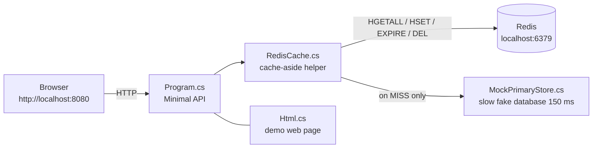
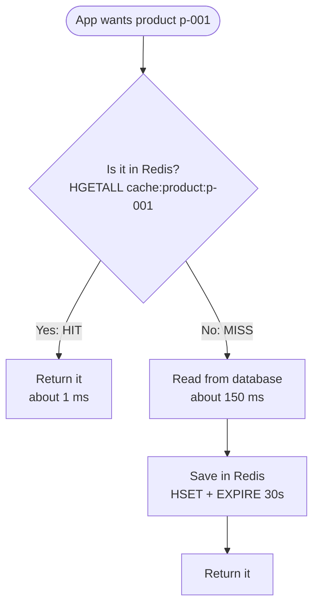
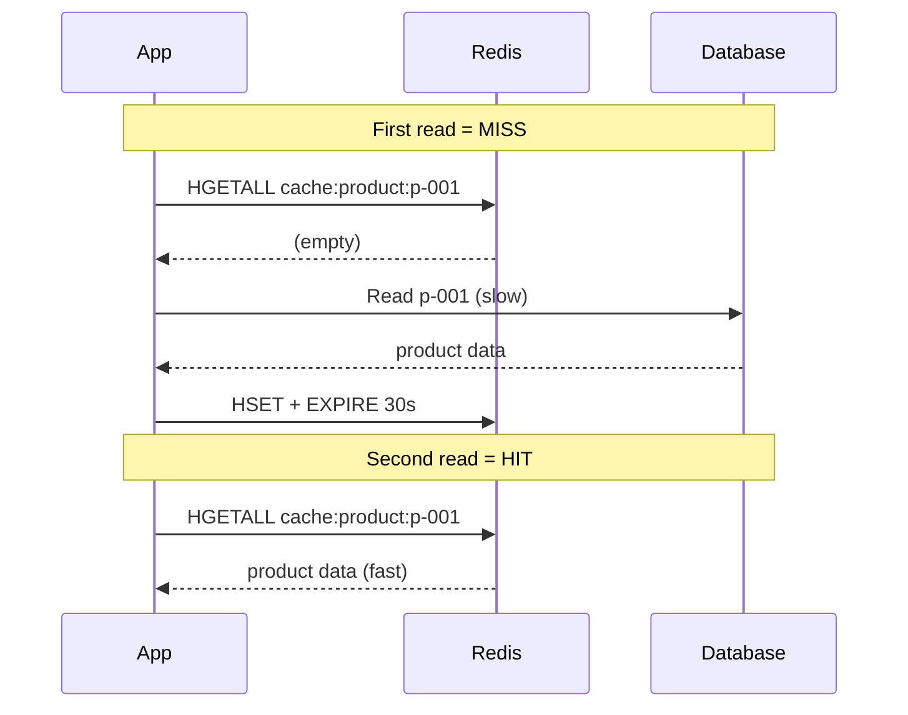
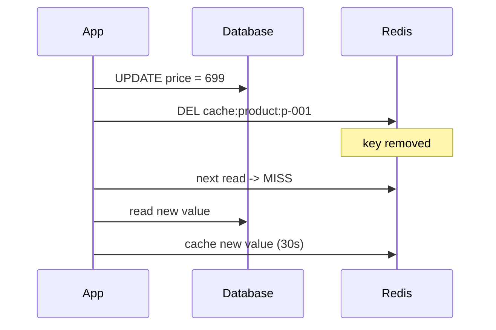
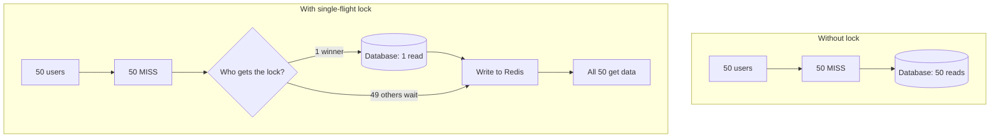

# Redis Cache-Aside - Easy Guide

## 1. What is it? (the library analogy)

- **Database** = a big warehouse. Accurate, but slow to walk to (150 ms in this demo).
- **Redis** = a small shelf next to your desk. Very fast (about 1 ms), but small.
- **Cache-aside** = the app first looks at the shelf. If the item is missing, the app walks to the
  warehouse, brings it back, and puts a copy on the shelf for next time.

The application is in charge of the cache. The database does not know Redis exists.

## 2. Project map



| File | Role |
|---|---|
| `Program.cs` | Web server and API endpoints |
| `RedisCache.cs` | The cache-aside logic (read, invalidate, TTL, lock, stats) |
| `MockPrimaryStore.cs` | Fake slow database with 5 products |
| `Html.cs` | The page you click on |

## 3. Reading data (HIT vs MISS)



Same flow as a timeline:



## 4. Why does a HIT turn into a MISS later? (TTL)

Each cached key lives for **30 seconds** (`ttl: 30` in `Program.cs`). After that Redis deletes it
by itself, so the next read is a MISS and reloads fresh data.

```mermaid
gantt
    title Life of one cache key (TTL = 30s)
    dateFormat  s
    axisFormat  %Ss
    section Cache state
    MISS - load from DB      :crit, 0, 1s
    HIT HIT HIT (fast)       :active, 1, 29s
    Key expired -> MISS again :crit, 30, 1s
    HIT again                :active, 31, 20s
```



Why TTL exists:
1. Limits how old the data can be (max 30 s stale).
2. Frees Redis memory automatically.
3. No cleanup code needed.

Check it yourself: `redis-cli TTL cache:product:p-001` counts down to 0, then the key is gone (`-2`).

## 5. Updating data (invalidate)

When data changes, **write the database first, then delete the cache key**. Do not try to edit the
cache copy to keep it in sync. The next read reloads fresh data.



Demo: click **Update** on the page, then **Read**. You will see a MISS.

## 6. Cache stampede (many users at once)

Imagine a popular key expires. 50 users ask at the same moment, all see MISS, and all 50 hit the
database. That is a **stampede**.

**Fix: single-flight lock.** Only one caller gets a short lock in Redis (Lua `SET NX PX`) and loads
from the database. The other 49 wait a moment and read the result from the cache.



Demo: press **Stampede test**. `primary_reads` should be **1**, and `stampedes_suppressed` in the
stats should be about 49.

## 7. Data model in Redis

Each product is a Redis **hash**:

```text
cache:product:p-001          (TTL 30s)
  id          = p-001
  name        = Sourdough Loaf
  price_cents = 650
  stock       = 42
```

Because it is a hash, one field can be updated without rewriting the whole record
(`UpdateField` in `RedisCache.cs`).

## 8. Redis commands used

| Command | Used for |
|---|---|
| `HGETALL` | Read the cached product |
| `HSET` + `EXPIRE` | Save after a MISS, with a 30 s TTL |
| `DEL` | Invalidate on write |
| `TTL` | Show remaining seconds |
| `EVAL` (Lua) | Acquire/release the stampede lock |

## 9. Run and try it

```powershell
# 1. Start Redis
docker run -p 6379:6379 redis

# 2. Start the app (note the extra "--" before the app arguments)
dotnet run -- --port 8080 --redis-host localhost --redis-port 6379
```

Open http://localhost:8080 and try this order:

| Step | Action | Expected |
|---|---|---|
| 1 | Read | MISS, about 150 ms |
| 2 | Read again | HIT, about 1 ms, TTL counting down |
| 3 | Wait 30 s, Read | MISS (key expired) |
| 4 | Update, then Read | MISS (invalidated) |
| 5 | Stampede test | `primary_reads = 1` |
| 6 | Stats | See hit rate and counters |

## 10. Cheat sheet

| Situation | Result |
|---|---|
| Key is in Redis | HIT (fast) |
| Key not in Redis | MISS (load from DB, then cache) |
| 30 s passed | Key expires, next read is MISS |
| Data updated | Delete key, next read is MISS |
| Many readers at once on a MISS | Only 1 reads the DB |
