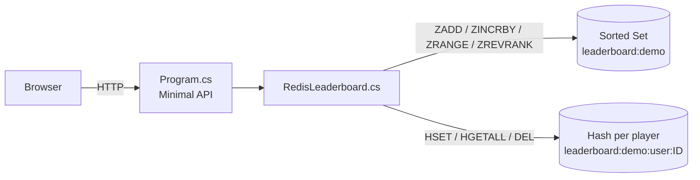
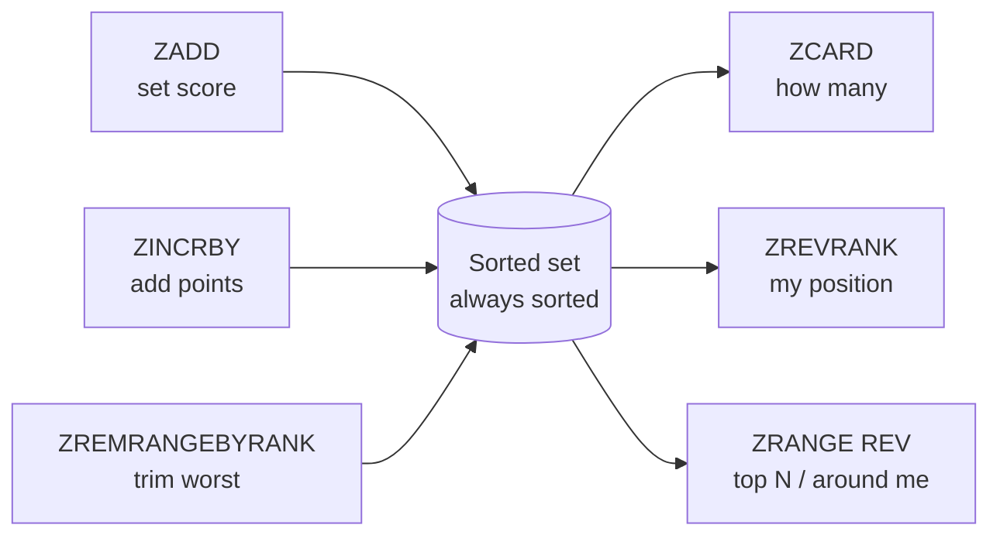
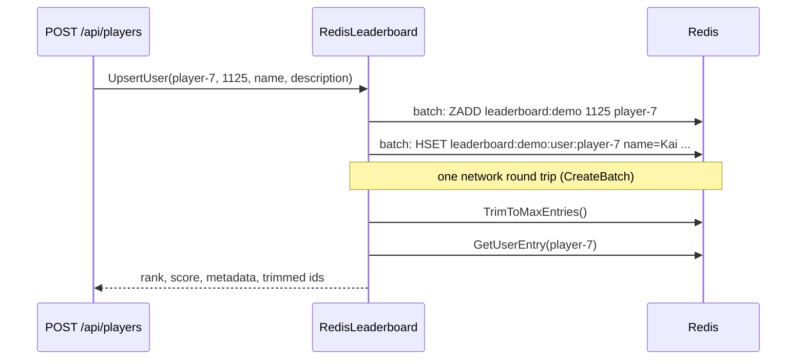
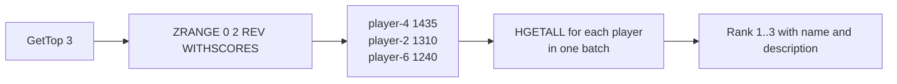
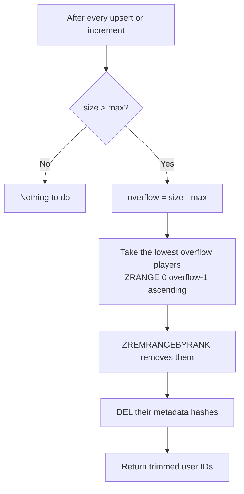

# Redis Leaderboard - Redis as the Primary Database

This project stores the whole leaderboard **only in Redis**. There is no SQL database behind it.
Redis is the source of truth, not a cache. Based on the
[Redis leaderboard use case](https://redis.io/docs/latest/develop/use-cases/leaderboard/).

## 1. The idea in one picture



Two Redis data types, each with one job:

| Data type | Key | Holds | Why |
|---|---|---|---|
| **Sorted set** | `leaderboard:demo` | player ID and score | Redis keeps it sorted by score automatically |
| **Hash** (one per player) | `leaderboard:demo:user:player-1` | `name`, `description` | Extra details, kept out of the sorted set so it stays small and fast |

Example of what is in Redis:

```text
leaderboard:demo                (sorted set)
  player-4 -> 1435
  player-2 -> 1310
  player-6 -> 1240
  player-3 -> 1175
  player-5 -> 1080
  player-1 -> 980

leaderboard:demo:user:player-4  (hash)
  name        = Priya
  description = Current pace-setter with a ruthless endgame.
```

You can look at it yourself:

```bash
redis-cli ZREVRANGE leaderboard:demo 0 -1 WITHSCORES
redis-cli HGETALL leaderboard:demo:user:player-4
```

## 2. Why Redis fits a leaderboard

In a SQL database, "what is player X's rank?" needs `ORDER BY score` over the whole table.
That is slow at millions of rows. A cache does not help because scores change on every action.

A sorted set stays ordered all the time, so ranking is cheap:

How to read the cost column (N = players on the board, M = players returned):

| Cost | Meaning | Example |
|---|---|---|
| O(1) | Same speed no matter how big the board is | Count of players |
| O(log N) | Grows very slowly: 1,000,000 players needs only about 20 steps | Find or update one player |
| O(log N + M) | Find the start (log N), then read M results | Top 10 on a 1,000,000 board |

| Operation | Redis command | Cost | What it means in this project |
|---|---|---|---|
| Add or set score | `ZADD` | O(log N) | Give a player a score: "Kai has 1125". Existing player: score replaced. New player: added. (`UpsertUser`) |
| Add points | `ZINCRBY` | O(log N), atomic | Give points: "Mina +25". (`IncrementScore`) |
| Rank of one player | `ZREVRANK` | O(log N) | Ask the position: "Noah is #4". (`GetRank`) |
| Top N or a slice | `ZRANGE ... REV` | O(log N + M) | Get a list: "top 5" or "players near rank 4". (`GetTop`, `GetAroundRank`) |
| Count entries | `ZCARD` | O(1) | Count players: "6 on the board". (`GetSize`) |

### What does `REV` mean?

`REV` means **reverse the order**: read the sorted set from the highest score down.

Redis always stores a sorted set from **lowest to highest** score:

```text
position:   0         1         2         3         4         5
player:     player-1  player-5  player-3  player-6  player-2  player-4
score:      980       1080      1175      1240      1310      1435
            lowest  ------------------------------------>  highest
```

A leaderboard wants the best player first, so `REV` flips the direction. The positions `0 2` stay
the same, only the direction changes:

```text
> ZRANGE leaderboard:demo 0 2
1) "player-1"      (980)    <- the 3 WORST players
2) "player-5"      (1080)
3) "player-3"      (1175)

> ZRANGE leaderboard:demo 0 2 REV
1) "player-4"      (1435)   <- the 3 BEST players (Top 3)
2) "player-2"      (1310)
3) "player-6"      (1240)
```

| Direction | Command | Position 0 is | Used in this project for |
|---|---|---|---|
| Ascending (default) | `ZRANGE key 0 2` | Lowest score | `TrimToMaxEntries`: find the worst players to remove |
| Descending | `ZRANGE key 0 2 REV` | Highest score | `GetTop` and `GetAroundRank` |

- In C#, `REV` is `Order.Descending` in `SortedSetRangeByRankWithScores`.
- The rank command works the same way: `ZRANK` counts from the lowest score, `ZREVRANK` counts
  from the highest, so the best player gets `0`. The code adds 1 to show "Rank 1".
- Before Redis 6.2 the same thing was a separate command, `ZREVRANGE`. `ZRANGE ... REV` needs
  Redis 6.2 or newer.

Example with the sample data, where the board has 6 players:

| Page action | Command sent | Result |
|---|---|---|
| Open the page, Top 3 | `ZRANGE leaderboard:demo 0 2 REV WITHSCORES` | Priya 1435, Mina 1310, Rin 1240 |
| Mina gets +200 | `ZINCRBY leaderboard:demo 200 player-2` | Mina 1510 and she becomes rank 1 |
| Where is Noah? | `ZREVRANK leaderboard:demo player-3` | `3` in Redis, shown as rank **4** |
| Stored entries | `ZCARD leaderboard:demo` | `6` |

Nothing re-sorts after these changes. Redis puts each player in the right position at write time,
so reads are always cheap.

### Try the operations in redis-cli

All five operations work on the **same sorted set**. Writes change it, reads see the change at once.



Open a CLI (`docker exec -it <container> redis-cli`, or `redis-cli`). The steps below use a scratch
key `leaderboard:cli`, so the app's `leaderboard:demo` is not touched. Run them in order.

**Step 1. `ZADD`: create the board (same 6 players as the app)**

```text
> ZADD leaderboard:cli 980 player-1 1310 player-2 1175 player-3 1435 player-4 1080 player-5 1240 player-6
(integer) 6
```
`6` means 6 new players were added.

**Step 2. `ZCARD`: how many players?**

```text
> ZCARD leaderboard:cli
(integer) 6
```

**Step 3. `ZRANGE ... REV`: read the board, best first**

```text
> ZRANGE leaderboard:cli 0 2 REV WITHSCORES
1) "player-4"
2) "1435"
3) "player-2"
4) "1310"
5) "player-6"
6) "1240"
```
`0 2` means positions 0 to 2, so this is the Top 3. `WITHSCORES` adds the score after each player.
Use `0 -1` for the whole board.

**Step 4. `ZREVRANK` and `ZSCORE`: look at one player**

```text
> ZREVRANK leaderboard:cli player-3
(integer) 3
> ZSCORE leaderboard:cli player-3
"1175"
```
Position `3` from the top starts at 0, so Noah is rank **4**. This matches Step 3: Noah comes after the 3 players shown.

**Step 5. `ZINCRBY`: add points, then see how the other operations react**

```text
> ZINCRBY leaderboard:cli 200 player-2
"1510"
> ZREVRANK leaderboard:cli player-2
(integer) 0
> ZREVRANK leaderboard:cli player-4
(integer) 1
> ZRANGE leaderboard:cli 0 2 REV WITHSCORES
1) "player-2"
2) "1510"
3) "player-4"
4) "1435"
5) "player-6"
6) "1240"
```
One write changed the answer of `ZREVRANK` and `ZRANGE`. Mina moved to the top and Priya dropped to
position 1, with no sorting step in between. `ZCARD` is still `6` because nobody was added.

**Step 6. `ZADD` again: new player vs existing player**

```text
> ZADD leaderboard:cli 1125 player-7
(integer) 1
> ZCARD leaderboard:cli
(integer) 7
> ZREVRANK leaderboard:cli player-7
(integer) 4
> ZADD leaderboard:cli 1300 player-7
(integer) 0
> ZREVRANK leaderboard:cli player-7
(integer) 2
> ZCARD leaderboard:cli
(integer) 7
```
- First `ZADD` returns `1`: a new player, so `ZCARD` goes from 6 to 7.
- Second `ZADD` returns `0`: the player already existed, only the score changed, so `ZCARD` stays 7.
- The player moved from position 4 to position 2 because the score went up.

This is what `UpsertUser` does for both "new player" and "edit player".

**Step 7. `ZRANGE` around a rank: what `GetAroundRank` does**

Player-7 is now rank 3 (position 2). To show 1 neighbor on each side, read positions 1 to 3:

```text
> ZRANGE leaderboard:cli 1 3 REV WITHSCORES
1) "player-4"
2) "1435"
3) "player-7"
4) "1300"
5) "player-6"
6) "1240"
```

**Step 8. Trim to 5 players: `ZRANGE` + `ZREMRANGEBYRANK` + `ZCARD`**

The board has 7 players and the limit is 5, so the overflow is `7 - 5 = 2`.

```text
> ZRANGE leaderboard:cli 0 1 WITHSCORES
1) "player-1"
2) "980"
3) "player-5"
4) "1080"
> ZREMRANGEBYRANK leaderboard:cli 0 1
(integer) 2
> ZCARD leaderboard:cli
(integer) 5
```
Without `REV`, position 0 is the **lowest** score. So the first two positions are the two worst
players. The app reads them first so it can also delete their metadata hashes.

**Step 9. Hash for the details: `HSET` and `HGETALL`**

```text
> HSET leaderboard:cli:user:player-7 name Kai description "New challenger"
(integer) 2
> HGETALL leaderboard:cli:user:player-7
1) "name"
2) "Kai"
3) "description"
4) "New challenger"
```
The sorted set answers "who is ahead". The hash answers "who is this". The app runs both for every
row it shows (`HydrateEntries`).

**Step 10. Delete a player, then clean up: `ZREM` and `DEL`**

```text
> ZREM leaderboard:cli player-7
(integer) 1
> DEL leaderboard:cli:user:player-7
(integer) 1
> DEL leaderboard:cli
(integer) 1
```
`ZREM` removes the score and `DEL` removes the hash. The app does both in `DeleteUser`. If you
only run `ZREM`, the hash stays behind as orphan data.

Quick map of how the commands depend on each other:

| If you run... | ...then these results change |
|---|---|
| `ZADD` new player | `ZCARD` +1, ranks of lower players +1 |
| `ZADD` existing player | `ZCARD` same, that player's rank may change |
| `ZINCRBY` | `ZCARD` same, `ZREVRANK` and `ZRANGE` order may change |
| `ZREMRANGEBYRANK` or `ZREM` | `ZCARD` smaller, ranks of lower players move up |
| `HSET` or `DEL` on a hash | Only the name and description change, rank and score do not |

`ZINCRBY` is atomic. There is no "read score, add, write back" step, so two simultaneous
increments cannot overwrite each other.

## 3. File map

| File | Role |
|---|---|
| `RedisLeaderboard.cs` | All leaderboard logic (this is the main thing to study) |
| `Program.cs` | HTTP API, seed data, embedded HTML page |

## 4. How each method works

Mapping from the C# method (StackExchange.Redis) to the Redis command:

| `RedisLeaderboard` method | StackExchange.Redis call | Redis command |
|---|---|---|
| `UpsertUser` | `SortedSetAddAsync` + `HashSetAsync` | `ZADD` + `HSET` |
| `IncrementScore` | `SortedSetIncrementAsync` + `HashSetAsync` | `ZINCRBY` + `HSET` |
| `GetTop(n)` | `SortedSetRangeByRankWithScores(0, n-1, Descending)` | `ZRANGE 0 n-1 REV WITHSCORES` |
| `GetAroundRank(rank, count)` | `SortedSetRangeByRankWithScores(start, end, Descending)` | `ZRANGE start end REV WITHSCORES` |
| `GetRank` | `SortedSetRank(..., Descending)` | `ZREVRANK` |
| `GetUserEntry` | `SortedSetScoreAsync` + `SortedSetRankAsync` + `HashGetAllAsync` | `ZSCORE` + `ZREVRANK` + `HGETALL` |
| `GetSize` | `SortedSetLength` | `ZCARD` |
| `DeleteUser` | `SortedSetRemoveAsync` + `KeyDeleteAsync` | `ZREM` + `DEL` |
| `TrimToMaxEntries` | `SortedSetRangeByRank` + `SortedSetRemoveRangeByRank` | `ZRANGE` + `ZREMRANGEBYRANK` |
| `Clear` | `KeyDelete(board + all user hashes)` | `DEL` |

### 4.1 Save a player (`UpsertUser`)



`CreateBatch()` sends the commands together, so it is fewer network round trips. A batch is not
a transaction, so it is not atomic as a group.

### 4.2 Add points (`IncrementScore`)

Same flow, but uses `ZINCRBY` instead of `ZADD`. If the player does not exist yet, Redis
creates it with the increment as the starting score.

```text
player-2 = 1310
IncrementScore(player-2, +25)  ->  ZINCRBY leaderboard:demo 25 player-2  ->  1335
```

### 4.3 Rank is 0-based in Redis, 1-based for humans

`ZREVRANK` returns 0 for the best player. The code adds 1 so the page shows "Rank 1".

```csharp
return rank is null ? null : (int)rank + 1;
```

`Order.Descending` means highest score first (this is the `REV` option).

### 4.4 Top N (`GetTop`)



`HydrateEntries` joins the two data types: the sorted set gives ID and score, then one batched
`HGETALL` per player gives the metadata.

### 4.5 Entries around a rank (`GetAroundRank`)

Used for "show me the players near me". The window is centered on the rank and pushed back
inside the board if it would go past the start or end:

```text
start = max(0, rank - 1 - count/2)
start = min(start, total - count)
end   = start + count - 1
```

Example with 6 players, `rank=3`, `count=5`: `start=0`, `end=4`, so ranks 1 to 5 are returned.

Example with `rank=6`, `count=5`: `start = 3`, clamped to `6 - 5 = 1`, so ranks 2 to 6 are returned.

If the board has `count` entries or fewer, `ListAll()` is used.

### 4.6 Fixed-size board (`TrimToMaxEntries`)

The board keeps only the top `MaxEntries` players (default 100).



The lowest scores are at the start of an ascending sorted set, so removing rank range
`0..overflow-1` drops the worst players. Their metadata hashes are deleted too, so no orphan
data is left behind.

## 5. API endpoints (`Program.cs`)

| Endpoint | Purpose | Method used |
|---|---|---|
| `GET /` | Demo web page | - |
| `GET /api/state?top=5&rank=3&around=5` | Top entries, entries around a rank, size | `GetTop`, `GetAroundRank`, `GetSize` |
| `POST /api/players` | Save a player (`user_id`, `score`, `name`, `description`) | `UpsertUser` |
| `POST /api/increment` | Add points (`user_id`, `amount`) | `IncrementScore` |
| `POST /api/config` | Change the max board size (`max_entries`) | `SetMaxEntries` |
| `POST /api/reset` | Clear and reseed 6 sample players | `Clear` + `UpsertUser` |

Notes:
- On startup the app seeds 6 sample players (`SeedSampleData`).
- A `lock (lockObj)` serializes API calls inside this one process. Only the trim step needs it.
  It does not help if you run more than one app instance.

## 6. Redis as a primary database: what changes vs a cache

In the cache-aside project, Redis could lose data because the database still had it. Here Redis is
the only copy, so durability matters.

| Topic | Cache (previous project) | Primary database (this project) |
|---|---|---|
| Source of truth | Database | **Redis** |
| TTL | Yes, keys expire | **No TTL**, data must stay |
| If Redis loses data | Reloaded from DB | **Data is gone** unless persisted |
| Persistence needed | No | **Yes: AOF or RDB** |
| Memory limit | Evict old keys | Evicting would delete real scores, so avoid it |

Things to configure when you use it for real:
- Persistence: enable AOF (`appendonly yes`) for the best durability, RDB snapshots for periodic backups.
- Eviction: use `maxmemory-policy noeviction` so Redis never silently drops leaderboard data.
- High availability: use replicas with Sentinel or Redis Cluster, or a managed service.
- Backups: copy the RDB or AOF files regularly.
- Plain Docker `redis` has no volume by default, so data is lost when the container is removed.
  Mount a volume, for example `docker run -p 6379:6379 -v redisdata:/data redis redis-server --appendonly yes`.

## 7. Limitations and things to know

- **Ties:** equal scores are ordered alphabetically by member name (`player-1` before `player-2`).
- **Scores are doubles:** very large or very precise numbers lose precision.
- **Trimming is not atomic:** between `ZADD` and the trim step another instance could add a
  player. For multiple instances, move the trim into a Lua script or use a transaction.
- **Batch is not a transaction:** `CreateBatch` groups commands for speed, not for atomicity.
- **Blocking calls:** the code uses `Task.WaitAll` and sync calls for simplicity. Use `await` and
  the async API in production.
- **Hash is separate from the sorted set:** a crash between `ZADD` and `HSET` could leave a
  player without metadata. A `MULTI/EXEC` transaction would close that gap.

## 8. Ideas from the Redis doc not in this project

The Redis page also mentions features you can add later:

| Feature | How |
|---|---|
| Daily, weekly, monthly boards | One sorted set per window, for example `leaderboard:2026-11-05`, with `EXPIRE` to clean up |
| Combined ranking over several windows | `ZUNIONSTORE` merges boards with weights |
| Ranking by any score | Same pattern for products, sellers or stocks |

## 9. Run and try it

```powershell
# Start Redis with persistence
docker run -p 6379:6379 -v redisdata:/data redis redis-server --appendonly yes

# Start the app (the extra "--" matters)
dotnet run -- --port 8081 --redis-host localhost --redis-port 6379
```

Open http://localhost:8081 and try:

| Step | Action | What to watch |
|---|---|---|
| 1 | Open the page | 6 sample players, Priya is rank 1 |
| 2 | Increment `player-2` by `+200` | Mina jumps to rank 1, ranks shift automatically |
| 3 | Save `player-7` with score `1125` | New player is placed by score |
| 4 | Set max size to `5` | The lowest player is trimmed, banner lists trimmed IDs |
| 5 | Change "Center rank" | "Entries around rank" shows the neighbors |
| 6 | `redis-cli ZREVRANGE leaderboard:demo 0 -1 WITHSCORES` | See the same data in Redis |
| 7 | Restart the app, do not click Reset | Data is still there (Redis is the database) |

> Note: `Program.cs` calls `SeedSampleData` on every start, and it begins with `Clear()`. So every
> app restart wipes the board and reloads the 6 sample players. That is fine for a demo, but remove
> it if you want real data to survive restarts.

## 10. Cheat sheet

| I want to... | Use |
|---|---|
| Set a player's score | `ZADD` |
| Add or subtract points | `ZINCRBY` |
| Top 10 | `ZRANGE 0 9 REV WITHSCORES` |
| A player's rank | `ZREVRANK` (add 1) |
| A player's score | `ZSCORE` |
| Players near me | `ZRANGE start end REV` |
| Number of players | `ZCARD` |
| Remove the worst players | `ZREMRANGEBYRANK 0 n-1` |
| Store name and avatar | Hash `HSET` / `HGETALL` |
